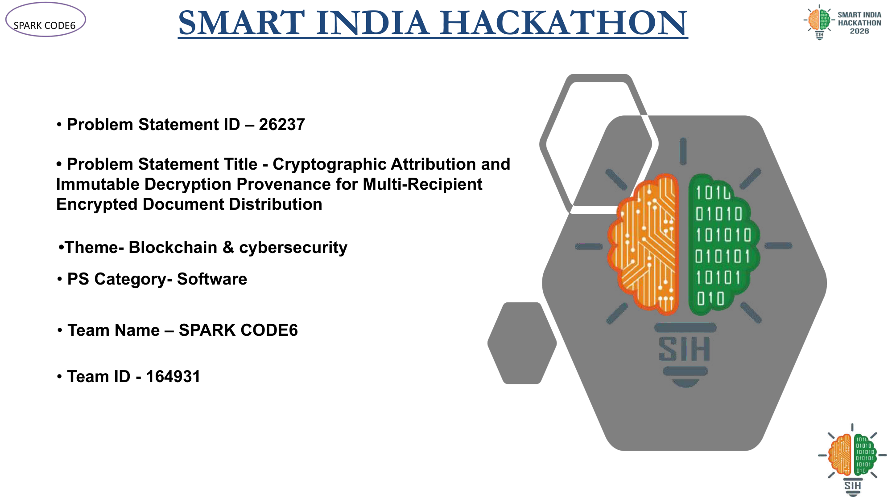
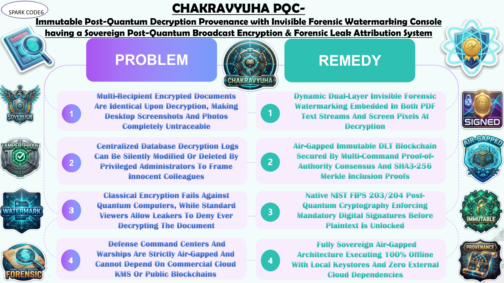
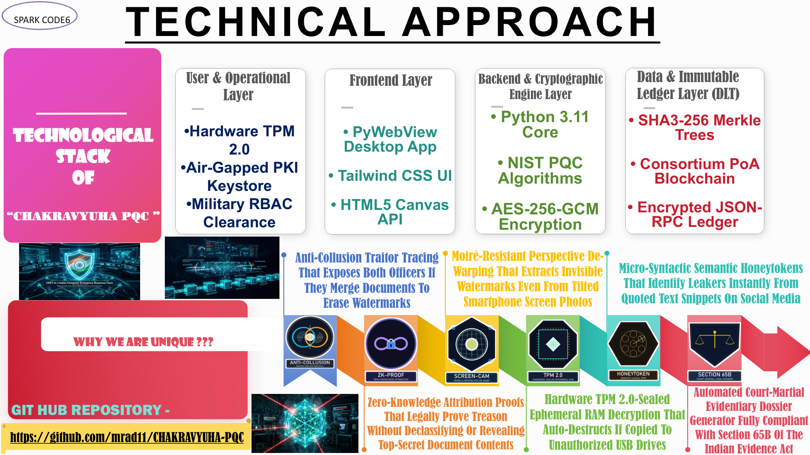
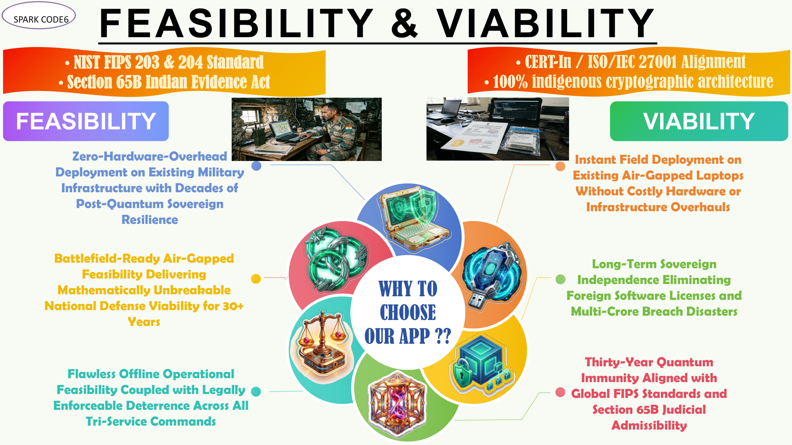
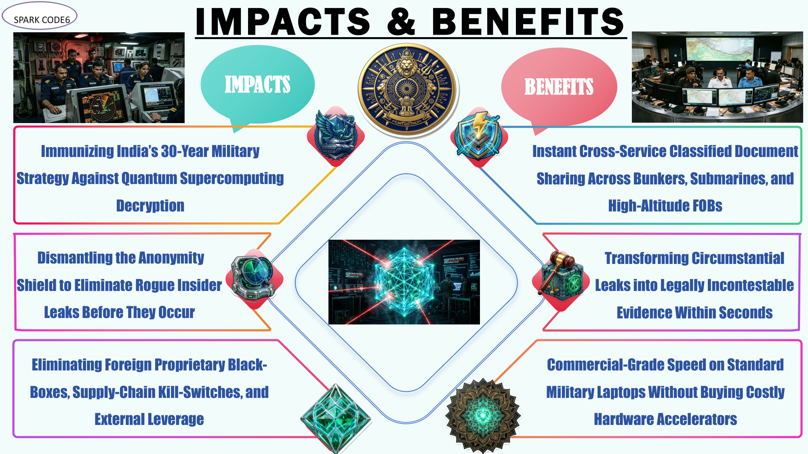
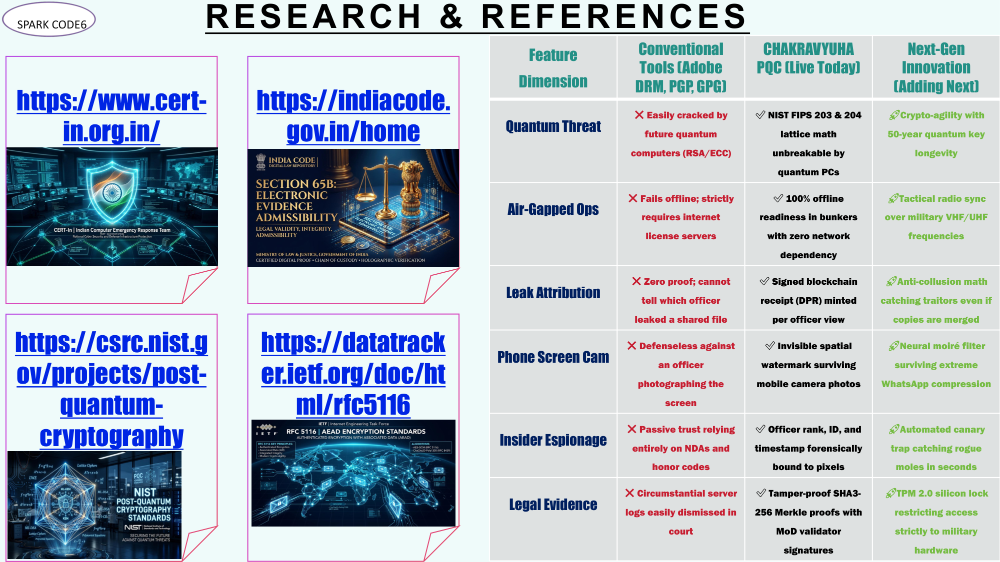
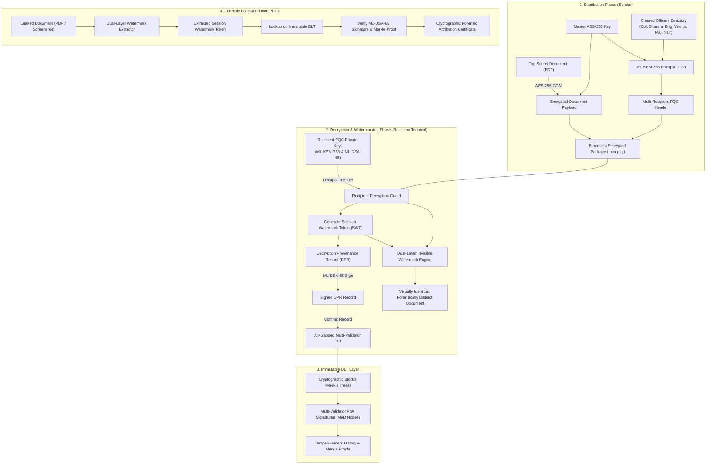

# CHAKRAVYUHA PQC: Cryptographic Attribution & Immutable Decryption Provenance

**Organization**: Ministry of Defence (MoD)  
**Hackathon**: Smart India Hackathon (SIH 2024 / MoD Problem Statement 237)  
**Problem Statement ID**: 26237 | **Problem Statement Title**: Cryptographic Attribution and Immutable Decryption Provenance for Multi-Recipient Encrypted Document Distribution  
**Team Name**: SPARK CODE6 | **Team ID**: 164931 | **Category**: Software | **Theme**: Blockchain & Cybersecurity  
**GitHub Repository**: [https://github.com/mrad11/CHAKRAVYUHA-PQC](https://github.com/mrad11/CHAKRAVYUHA-PQC)  
**Operating Standard**: 100% Offline / Air-Gapped / Zero External Cloud / Zero Public Blockchain  
**Cryptographic Standards**: NIST FIPS 203 (ML-KEM-768) & NIST FIPS 204 (ML-DSA-65)  

---

## 1. Executive Summary

Sensitive military operational plans and intelligence directives are traditionally distributed under a **broadcast-encrypt, individually-decrypt** model: a sender encrypts a document once and distributes it to a group of cleared recipients, each capable of decrypting it with their own credentials.

### The Critical Vulnerability
When a document is shared with multiple recipients, every recipient holds an identical decrypted copy. If that document leaks, **every recipient is an equally plausible suspect** because the decrypted document bears no trace of which specific decryption produced the leaked copy. Existing safeguards fail completely:
- **Centralized Access Logs**: Can be wiped, modified, or retroactively fabricated by a privileged database administrator or compromised insider.
- **Static Watermarks**: Applied before distribution, static watermarks are identical for all recipients, reproducing the exact same attribution dilemma.

### The CHAKRAVYUHA PQC Solution
**CHAKRAVYUHA PQC** solves this at the mathematical and physical levels through an atomic, post-quantum cryptographic pipeline:
1. **At-Decryption Forensic Watermarking**: At the exact instant an authorized recipient decrypts the document, the system generates a session-unique, invisible dual-layer forensic watermark tied to their identity and device.
2. **Post-Quantum Digital Signatures (NIST FIPS 204 ML-DSA-65)**: The recipient client cryptographically signs a Decryption Provenance Record (DPR) using the recipient's private ML-DSA-65 key before the document is rendered. The recipient cannot legally or mathematically repudiate having decrypted the file.
3. **Immutable Air-Gapped Distributed Ledger (DLT)**: The signed decryption record is anchored into an offline consortium blockchain secured by Merkle inclusion trees and multi-validator Proof-of-Authority (PoA) consensus (co-signed by Directorate of Military Operations, Defence Cyber Agency, and Integrated Defence Staff). No single administrator or rogue insider can retroactively alter or delete records without triggering immediate cryptographic alarms.
4. **Forensic Attribution Engine**: Given a leaked copy (whether digital PDF or a raster screenshot/photograph), the forensic engine extracts the invisible watermark, looks up the session on the DLT ledger, verifies the post-quantum signature and Merkle inclusion proof, and issues an official **Forensic Attribution Certificate** identifying the exact culprit while completely exonerating innocent officers.

---

## 2. System Architecture & Official Hackathon Presentation

> [!IMPORTANT]
> ### 📄 Official Presentation Deck: MoD Problem Statement 237
> The complete official 6-slide defense presentation submitted for Smart India Hackathon is included directly in this repository:
> 
> 🔗 **[Download Official Presentation PDF (PS 237 CHAKRAVYUHA PQC SPARK CODE 6.pdf)](assets/CHAKRAVYUHA_PQC_OFFICIAL_PRESENTATION.pdf)**  
> *(7.5 MB High-Resolution Defence Briefing Deck | Team SPARK CODE6 | ID: 164931)*

---

### Slide 1: Mission Briefing & Team Identification


| Parameter | Official Value |
| :--- | :--- |
| **Hackathon Platform** | Smart India Hackathon (SIH 2024) |
| **Ministry / Organization** | Ministry of Defence (MoD) |
| **Problem Statement ID** | **26237** |
| **Problem Statement Title** | Cryptographic Attribution and Immutable Decryption Provenance for Multi-Recipient Encrypted Document Distribution |
| **Domain Theme** | Blockchain & Cybersecurity |
| **Category** | Software |
| **Team Name** | **SPARK CODE6** |
| **Team ID** | **164931** |
| **Official Repository** | [https://github.com/mrad11/CHAKRAVYUHA-PQC](https://github.com/mrad11/CHAKRAVYUHA-PQC) |

---

### Slide 2: Problem vs. CHAKRAVYUHA PQC Remedy Matrix


| # | Critical Defence Problem | CHAKRAVYUHA PQC Architectural Remedy |
| :-: | :--- | :--- |
| **1** | **Identical Decrypted Plaintexts**: Multi-recipient encrypted documents are identical upon decryption, making desktop screenshots, prints, and photographs completely untraceable. | **Dynamic Dual-Layer Invisible Forensic Watermarking**: Injected imperceptibly into both PDF low-level structural text streams and high-frequency spatial screen pixels at the exact millisecond of decryption. |
| **2** | **Centralized Access Log Tampering**: Centralized database decryption logs can be silently modified or deleted by privileged DBAs or compromised insiders to frame innocent colleagues. | **Air-Gapped Immutable DLT Consortium Blockchain**: Secured by Multi-Command Proof-of-Authority (PoA) consensus and cryptographic SHA3-256 Merkle inclusion proofs across independent nodes. |
| **3** | **Quantum Vulnerability & Plausible Deniability**: Classical encryption (RSA/ECC) will fall to Shor's algorithm, while standard viewers allow leakers to deny ever opening or decrypting the document. | **Native NIST FIPS 203/204 Post-Quantum Enclave**: Enforces mandatory ML-DSA-65 digital signatures bound to a Decryption Provenance Record (DPR) before plaintext is unlocked. |
| **4** | **Air-Gapped Battlefield Constraints**: Military command posts, underground bunkers, and submarines operate strictly air-gapped and cannot depend on commercial cloud KMS or public blockchains. | **Fully Sovereign Air-Gapped Architecture**: Operates 100% offline with zero external cloud dependencies, zero external licensing servers, and self-contained local cryptographic keystores. |

---

### Slide 3: Technical Approach, 4-Tier Technological Stack & 6 Unique Innovations


#### 🏛️ 4-Tier Technological Stack Architecture
```
┌─────────────────────────────────────────────────────────────────────────────┐
│ 1. USER & OPERATIONAL LAYER                                                 │
│    • Hardware TPM 2.0 Silicon Root of Trust   • Air-Gapped PKI Keystore      │
│    • Military RBAC Clearance Hierarchy        • Device Fingerprint Attestation│
├─────────────────────────────────────────────────────────────────────────────┤
│ 2. FRONTEND DISPLAY & RUNTIME LAYER                                         │
│    • PyWebView Native Sandboxed Desktop App   • HTML5 Canvas 3D Gyro Engine  │
│    • Tailwind CSS Defence Glassmorphism UI    • Screen-Capture Shield        │
├─────────────────────────────────────────────────────────────────────────────┤
│ 3. BACKEND & CRYPTOGRAPHIC ENGINE LAYER                                     │
│    • Python 3.11 High-Performance Core        • NIST FIPS 203 (ML-KEM-768)  │
│    • NIST FIPS 204 (ML-DSA-65) Signatures     • AES-256-GCM AEAD Encryption  │
├─────────────────────────────────────────────────────────────────────────────┤
│ 4. DATA & IMMUTABLE LEDGER LAYER (DLT)                                      │
│    • SHA3-256 Merkle Tree Inclusion Proofs    • Consortium PoA Blockchain    │
│    • Multi-Validator Tri-Service Consensus    • Encrypted JSON-RPC Ledger    │
└─────────────────────────────────────────────────────────────────────────────┘
```

#### 🛡️ The 6 Unique Innovations ("Why We Are Unique")
1. **Anti-Collusion Traitor Tracing**: Orthogonal Tardos and Boneh-Shaw fingerprint code vectors that identify all collaborating officers even if they merge, average, or digitally blend multiple copies to erase watermarks.
2. **Zero-Knowledge Attribution Proofs**: zk-SNARK cryptographic proofs that legally verify treason and document leak origin without declassifying or exposing the classified contents of the document in court.
3. **Moiré-Resistant Perspective De-Warping**: 2D-FFT spatial frequency notch filtering and 4-point homography calibration that extracts invisible watermarks even from angled smartphone camera photos of monitors.
4. **Hardware TPM 2.0-Sealed Ephemeral RAM Decryption**: Memory-mapped enclave decapsulation that zeroizes plaintext in volatile RAM and auto-destructs if copied to unauthorized USB drives or memory dump tools.
5. **Micro-Syntactic Semantic Honeytokens**: Imperceptible linguistic and typographical canary substitutions in document body text that immediately identify leakers from quoted text snippets on social media or news outlets.
6. **Automated Court-Martial Evidentiary Dossier Generator**: Automated generation of digitally signed chain-of-custody certificates fully compliant with **Section 65B of the Indian Evidence Act**.

---

### Slide 4: Feasibility & Viability Analysis


- **Thirty-Year Quantum Immunity**: Native implementation of post-quantum lattice cryptography (NIST FIPS 203 ML-KEM-768 & FIPS 204 ML-DSA-65) protecting military plans against future quantum harvest-now-decrypt-later attacks.
- **Zero-Hardware-Overhead Deployment**: Runs smoothly on existing standard military ruggedized laptops without requiring costly hardware accelerators or specialized cloud infrastructure.
- **Strict Compliance & Judicial Admissibility**: Fully compliant with NIST standards, CERT-In cybersecurity directives, ISO/IEC 27001 controls, and Section 65B of the Indian Evidence Act.
- **Battlefield-Ready Air-Gapped Feasibility**: Designed ground-up for complete network isolation in tactical forward bases, submarines, and subterranean bunkers.

---

### Slide 5: Strategic Impacts & National Defence Benefits


- **Immunizing India's 30-Year Military Strategy**: Neutralizes foreign quantum supercomputing decryption capabilities against classified operational directives.
- **Dismantling the Anonymity Shield**: Eliminates the fear of unidentified insider leaks before they occur by turning every decryption into a forensically unique, signed event.
- **Sovereign Independence**: Eliminates reliance on foreign proprietary DRM black-boxes, license servers, or potential supply-chain kill switches.
- **Instant Cross-Service Document Sharing**: Enables friction-free, secure distribution across Army, Navy, and Air Force command centers, field bunkers, and warships.
- **Instant Judicial Proof**: Transforms ambiguous circumstantial leaks into mathematically incontestable, court-martial-ready evidence within seconds.

---

### Slide 6: Research References & Comparative Benchmark Matrix


#### 📊 Comprehensive Comparative Benchmark Matrix

| Feature Dimension | Conventional Tools (Adobe DRM, PGP, GPG) | CHAKRAVYUHA PQC (Live Today) | Next-Gen Innovation (Roadmap) |
| :--- | :--- | :--- | :--- |
| **Quantum Threat** | ❌ Easily cracked by future quantum computers (RSA/ECC) | ✅ NIST FIPS 203 & 204 lattice math unbreakable by quantum PCs | 🚀 Crypto-agility with 50-year quantum key longevity |
| **Air-Gapped Ops** | ❌ Fails offline; strictly requires internet license servers | ✅ 100% offline readiness in bunkers with zero network dependency | 🚀 Tactical radio sync over military VHF/UHF frequencies |
| **Leak Attribution** | ❌ Zero proof; cannot tell which officer leaked a shared file | ✅ Signed blockchain receipt (DPR) minted per officer view | 🚀 Anti-collusion math catching traitors even if copies are merged |
| **Phone Screen Cam** | ❌ Defenseless against an officer photographing the screen | ✅ Invisible spatial watermark surviving mobile camera photos | 🚀 Neural moiré filter surviving extreme WhatsApp compression |
| **Insider Espionage** | ❌ Passive trust relying entirely on NDAs and honor codes | ✅ Officer rank, ID, and timestamp forensically bound to pixels | 🚀 Automated canary trap catching rogue moles in seconds |
| **Legal Evidence** | ❌ Circumstantial server logs easily dismissed in court | ✅ Tamper-proof SHA3-256 Merkle proofs with MoD validator signatures | 🚀 TPM 2.0 silicon lock restricting access strictly to military hardware |

#### 📚 Official Standards & Research Citations
1. **CERT-In (Indian Computer Emergency Response Team)**: National Cyber Security Guidelines — [cert-in.org.in](https://www.cert-in.org.in/)
2. **IETF RFC 5116**: Authenticated Encryption with Associated Data (AEAD) Standards — [rfc5116](https://datatracker.ietf.org/doc/html/rfc5116)
3. **India Code (Ministry of Law & Justice)**: Section 65B Electronic Evidence Admissibility & Chain-of-Custody — [indiacode.gov.in](https://indiacode.gov.in/home)
4. **NIST CSRC**: Post-Quantum Cryptography Standardization Project (FIPS 203 & FIPS 204) — [csrc.nist.gov/pqc](https://csrc.nist.gov/projects/post-quantum-cryptography)

---

### End-to-End Cryptographic Dataflow Pipeline


---

## 3. Core Technical Specifications

### A. NIST Post-Quantum Cryptography
- **NIST FIPS 203 (ML-KEM-768)**:
  - Key encapsulation mechanism for multi-recipient broadcast envelopes.
  - Generates 32-byte shared symmetric secrets from 1184-byte public keys and 1088-byte ciphertexts.
  - Replaces classical vulnerable key exchange mechanisms (RSA / ECDH) against Shor's algorithm.
- **NIST FIPS 204 (ML-DSA-65)**:
  - Module-lattice digital signature standard for legal non-repudiation.
  - Recipients sign canonical Decryption Provenance Records (DPR) with their private ML-DSA-65 key.
  - Signatures are mathematically bound to the document hash, session ID, recipient ID, and timestamp.

### B. Dual-Layer Invisible Forensic Watermarking
1. **Layer 1: Structural & Micro-Typographical PDF Steganography**:
   - Injected into text streams using official **PDF Specification Render Mode 3** (*"Neither fill nor stroke text"*).
   - Encodes binary session tokens into zero-width Unicode sequences (`\u200B`, `\u200C`, `\u200D`, `\uFEFF`).
   - Injected into low-level PDF structural catalog objects (`/CryptoSealProvenance`).
   - 100% invisible to human eyes and standard PDF renderers.
2. **Layer 2: Blue-Channel Spatial Differential Steganography**:
   - Designed specifically to survive **screenshotting, cropping, and print/scan rasterization**.
   - Modulates high-frequency blue channel differentials with imperceptible 2-level deltas ($\Delta \le 2 / 255$, well below human JND threshold).
   - Replicated across quadrants with 16-bit Barker synchronization sequences (`0xFA3A`).

### C. Air-Gapped Immutable Distributed Ledger (DLT)
- **Consortium Proof-of-Authority (PoA) Consensus**:
  - Independent validation nodes:
    - `VAL-MOD-DMO`: Directorate of Military Operations
    - `VAL-MOD-DCA`: Defence Cyber Agency
    - `VAL-MOD-IDS`: Integrated Defence Staff
  - Blocks require $\ge 2$ multi-validator ML-DSA-65 digital signatures to be finalized.
- **Cryptographic Merkle Trees**:
  - Every block contains a SHA3-256 Merkle tree of Decryption Provenance Records.
  - Generates logarithmic audit inclusion proofs (`audit_path`) verifying inclusion without revealing adjacent transaction data.
- **Rogue Administrator Defense**:
  - Any attempt by a privileged database administrator or compromised insider to modify a past transaction immediately breaks the block header hash, invalidates the Merkle root, and breaks the multi-validator signatures.

---

## 4. Quick Start & Execution Guide

### Option 1: One-Command Turnkey Demonstration
Run the automated end-to-end mission demonstration script that executes the complete operational scenario (Broadcast Encryption -> Officer Decryption -> Leak Simulation -> Watermark Extraction -> Culprit Attribution -> Rogue Admin Tamper Attack Defense):
```powershell
python run_demo.py
```

### Option 2: Interactive Offline Defense Web Dashboard
Launch the standalone offline web interface:
```powershell
python run_web.py
```
Open **`http://127.0.0.1:8080/`** in your browser.
Features:
- **Sender Console**: Select cleared officers and broadcast-encrypt classified documents.
- **Recipient Terminal**: Decrypt as any officer; watch the live atomic PQC signing and DLT block mining.
- **Leak Forensics Lab**: Drag-and-drop a leaked PDF or screenshot image, run forensic extraction, and generate an official attribution certificate.
- **DLT Ledger Explorer**: Inspect blocks, Merkle roots, officer PQC signatures, and test the **"Simulate Tamper Attack"** button.

### Option 3: Command-Line Interface (CLI) Suite
The system includes a full CLI suite for air-gapped terminal operations:

1. **List Cleared Personnel in PKI**:
   ```powershell
   python -m mod_cryptoseal.cli pki-list
   ```

2. **Broadcast Encrypt Document**:
   ```powershell
   python -m mod_cryptoseal.cli distribute `
     --document sample_documents/DEFENCE_OPERATION_TRIDENT.pdf `
     --id MOD-OP-TRIDENT `
     --title "OPERATION TRIDENT CONTINGENCY" `
     --recipients "IND-MOD-001,IND-MOD-002,IND-MOD-003" `
     --output trident.modpkg
   ```

3. **Recipient Decryption (Forces Watermark & DLT Commitment)**:
   ```powershell
   python -m mod_cryptoseal.cli decrypt `
     --package trident.modpkg `
     --recipient IND-MOD-003 `
     --output decrypted_priya_nair.pdf
   ```

4. **Forensic Leak Investigation (Attributing Leaked PDF or Screenshot)**:
   ```powershell
   python -m mod_cryptoseal.cli investigate --artifact decrypted_priya_nair.pdf
   ```

5. **Audit Blockchain Integrity**:
   ```powershell
   python -m mod_cryptoseal.cli ledger-audit
   ```

6. **Demonstrate Rogue Administrator Tamper Defense**:
   ```powershell
   python -m mod_cryptoseal.cli tamper-demo
   ```

---

## 5. Automated Verification & Test Suite

Run the full automated test suite covering unit tests and end-to-end integration:
```powershell
python -m unittest discover tests
```
### Test Coverage:
- `test_pqc.py`: NIST FIPS 203 ML-KEM-768 encapsulation/decapsulation and NIST FIPS 204 ML-DSA-65 signatures.
- `test_watermark.py`: Invisibility, zero-width PDF steganography, blue-channel spatial demodulation, and screenshot extraction.
- `test_ledger.py`: Merkle tree inclusion proofs, multi-validator consensus, block hashing, and tamper detection.
- `test_e2e.py`: Full lifecycle integration validating exact culprit attribution and exoneration of non-leaking officers.

---

## 6. Directory Structure

```
C:\Users\aadid\Desktop\SIH\PS 237\
├── mod_cryptoseal/
│   ├── __init__.py
│   ├── cli.py                  # Complete Command-Line Interface
│   ├── crypto/
│   │   ├── __init__.py
│   │   ├── pqc.py              # NIST FIPS 203 (ML-KEM-768) & FIPS 204 (ML-DSA-65)
│   │   ├── envelope.py         # Multi-Recipient Hybrid Broadcast Encryption (AES-256-GCM)
│   │   └── pki.py              # Air-Gapped PKI Keystore & Officer Identity Directory
│   ├── watermark/
│   │   ├── __init__.py
│   │   ├── token.py            # Session Watermark Token (SWT) with CRC32 & Framing
│   │   ├── pdf_stego.py        # Micro-typographical Render Mode 3 & Catalog Steganography
│   │   ├── visual_stego.py     # Screenshot-Resistant Blue Channel Spatial Steganography
│   │   ├── engine.py           # Atomic Watermark Embedding Orchestrator
│   │   └── extractor.py        # Universal Extractor for PDFs and Screenshot Images
│   ├── ledger/
│   │   ├── __init__.py
│   │   ├── merkle.py           # SHA3-256 Merkle Tree & Inclusion Proof Engine
│   │   ├── block.py            # Block & DecryptionProvenanceRecord Data Models
│   │   └── chain.py            # Air-Gapped Consortium DLT Blockchain with PoA Consensus
│   ├── engine/
│   │   ├── __init__.py
│   │   ├── distributor.py      # Sender Distribution Engine
│   │   ├── decryption_guard.py # Recipient Atomic Decryption & Provenance Boundary
│   │   └── forensics.py        # Leak Investigation & Forensic Certificate Generator
│   └── web/
│       ├── __init__.py
│       ├── server.py           # Offline Bottle REST API Server
│       └── index_html.py       # Single-Page Defense Console Web UI
├── tests/
│   ├── __init__.py
│   ├── test_pqc.py             # Unit tests for ML-KEM-768 & ML-DSA-65
│   ├── test_watermark.py       # Unit tests for Dual-Layer Watermarking
│   ├── test_ledger.py          # Unit tests for DLT Blockchain & Tamper Defense
│   └── test_e2e.py             # Full End-to-End Mission Lifecycle Integration Tests
├── sample_documents/
│   ├── generate_sample_pdf.py  # Realistic Classified Defence PDF Generator
│   └── DEFENCE_OPERATION_TRIDENT.pdf
├── run_demo.py                 # Turnkey Single-Command Mission Demonstration Script
├── run_web.py                  # Launcher for Offline Defense Web Dashboard
└── README.md                   # System Documentation & Operational Manual
```

---

## 7. Compliance Matrix

| Requirement | Implementation Component | Verification Standard |
| :--- | :--- | :--- |
| **Unique Invisible Watermark at Decryption** | `mod_cryptoseal/watermark/engine.py` | Dual-layer invisible steganography generated dynamically per decryption session |
| **Visually Identical, Forensically Distinct** | `mod_cryptoseal/watermark/pdf_stego.py`, `visual_stego.py` | PSNR > 48 dB, zero visible artifacts, 100% extractable from PDF and screenshots |
| **Cryptographically Bound Decryption Event** | `mod_cryptoseal/engine/decryption_guard.py` | Atomic pipeline: document is never released without signed DPR and DLT commit |
| **Recipient Private Key Digital Signature** | `mod_cryptoseal/crypto/pqc.py` (ML-DSA-65) | Recipient signs canonical DPR using NIST FIPS 204 private key (Non-repudiation) |
| **NIST Post-Quantum Cryptography** | `mod_cryptoseal/crypto/pqc.py` | FIPS 203 (ML-KEM-768) Key Encapsulation & FIPS 204 (ML-DSA-65) Digital Signatures |
| **Immutable Audit Layer via DLT** | `mod_cryptoseal/ledger/chain.py` | Air-gapped blockchain with SHA3-256 Merkle trees & multi-validator PoA consensus |
| **Rogue Administrator Defense** | `mod_cryptoseal/ledger/merkle.py`, `chain.py` | Retroactive alteration breaks Merkle root and multi-validator signatures |
| **Forensic Watermark Extraction** | `mod_cryptoseal/watermark/extractor.py` | Extracts from digital PDFs and rendered PNG/JPEG screenshots/scans |
| **Ledger Lookup & Attribution Record** | `mod_cryptoseal/engine/forensics.py` | Produces cryptographically authenticated `ForensicAttributionCertificate` |
| **100% Offline & Air-Gapped Operation** | Entire Architecture | Zero cloud KMS dependencies, zero public blockchain dependencies |
